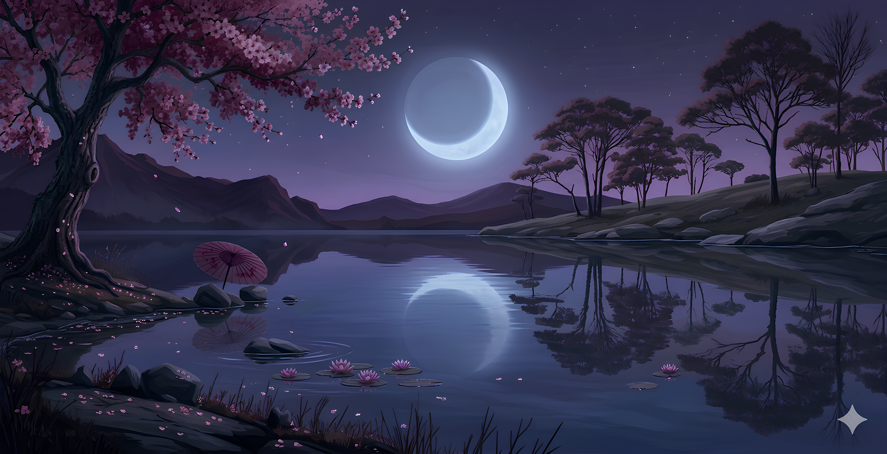

# Sakurazuki

A dark Omarchy theme combining the deep purple, pink, cyan, and pastel colours of [Archwave by David Guttman](https://github.com/davidguttman/archwave) with wallpapers from [Michal-Nithesh/Sakurazuki](https://github.com/Michal-Nithesh/Sakurazuki).



## Install

On an Omarchy installation with `colors.toml` theme support:

```bash
omarchy theme install https://github.com/adamcbrewer/omarchy-sakurazuki-theme.git
```

This installs and applies the theme. To switch back to it later:

```bash
omarchy theme set sakurazuki
```

Cycle the two included wallpapers with:

```bash
omarchy theme bg next
```

Omarchy generates the terminal, editor, shell, and border colours from `colors.toml`. GTK applications keep Omarchy's standard dark appearance. The theme keeps your existing desktop layout, plugins, keybindings, and window behaviour.

There are no installer scripts or package dependencies, following the [minimal dependency principle](https://github.com/lirantal/npm-security-best-practices#14-reduce-your-package-dependency-tree).

## Palette

| Role | Colour |
| --- | --- |
| Background | `#1a0d2e` |
| Surface / selection | `#2d1b4e` |
| Foreground | `#d4a5ff` |
| Bright foreground | `#fef6ff` |
| Muted text / inactive border | `#543a6e` |
| Pink accent / active border | `#ff6ec7` |
| Cyan / green | `#5ffbf1` |
| Yellow | `#f9f871` |
| Blue | `#8b9aff` |
| Magenta | `#f4a5ff` |

The palette maps Archwave's [terminal colours](https://github.com/davidguttman/archwave/blob/b3e6b814989dc5dd58b25bc4c73667b4827bcb4c/alacritty.toml) and [editor surface and text colours](https://github.com/davidguttman/archwave/blob/b3e6b814989dc5dd58b25bc4c73667b4827bcb4c/neovim.lua) into Omarchy's semantic palette. The active border uses Archwave's solid pink; the inactive border uses its muted purple. Omarchy generates its standard terminal slots and cursor from these semantic colours.

## Wallpapers

- [Sakura](backgrounds/sakura.png)
- [Moonlit Valley Retreat](backgrounds/moonlit-valley-retreat.png)

Both are copied unchanged from [Michal-Nithesh/Sakurazuki](https://github.com/Michal-Nithesh/Sakurazuki). See [CREDITS.md](CREDITS.md) for the source revision and retained upstream licence.

## Credits and licence

Palette: [davidguttman/archwave](https://github.com/davidguttman/archwave). Wallpapers: [Michal-Nithesh/Sakurazuki](https://github.com/Michal-Nithesh/Sakurazuki).

The new theme definition and documentation are [MIT licensed](LICENSE). The wallpaper source's MIT notice is retained separately in [LICENSES](LICENSES/Michal-Nithesh-Sakurazuki-MIT.txt).

Theme format: [Omarchy theming documentation](https://github.com/omacom/omarchy/blob/quattro/docs/theming.md).
